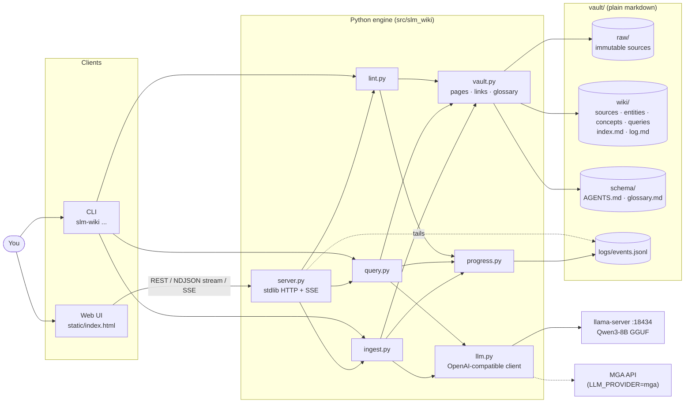
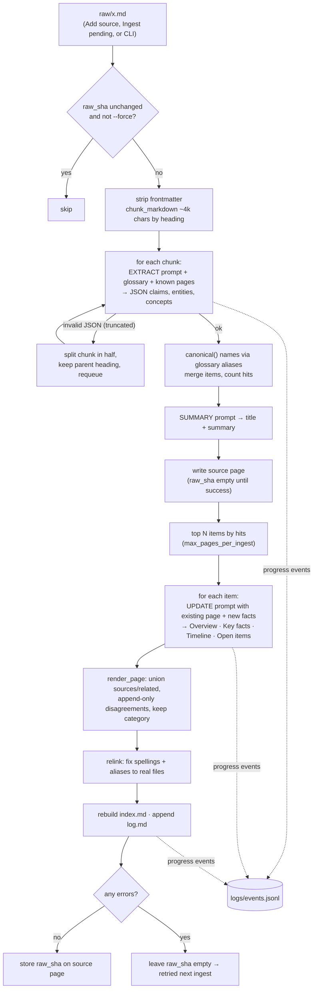
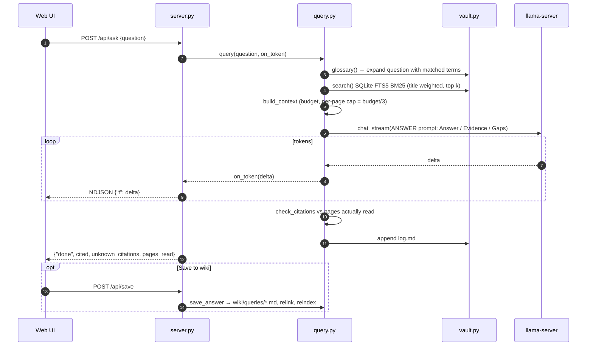

# SLM Wiki

[Karpathy's LLM Wiki](https://gist.github.com/karpathy/442a6bf555914893e9891c11519de94f) on a local 8B model. llama.cpp is the model, a small Python engine is the disciplined maintainer, and a local web UI (inspired by [MindBase](https://github.com/frankchu91/mindbase-llm-wiki)) is where you browse, ask, and add sources. Everything is plain markdown on disk.

## Setup

```bash
brew install llama.cpp                 # or LLAMA_SERVER=/path/to/llama-server
uv sync
cp .env.example .env
./scripts/start_llama.sh               # serves models/qwen3-8b on :18434
uv run slm-wiki serve                  # opens http://127.0.0.1:8765
```

## The UI

| Area | What it does |
|---|---|
| Left | Pages grouped by Projects / People / Tools / Concepts / Questions / Sources, plus raw files marked ✓ in wiki or ✨ pending. Filter as you type; ⌘K focuses, Enter runs full-text search. |
| Center | Home dashboard, rendered pages with clickable `[[links]]` and backlinks, a graph view, the Index / Log / Glossary. |
| Right · Ask | Streaming answers as Answer / Evidence / Gaps with clickable citations and the pages read. **Save to wiki** files an answer as a page so explorations compound. |
| Right · Activity | Live progress of every ingest, query, and lint, including ones started from the CLI. |
| Top bar | **+ Add source** (drop .md/.txt or paste text → saved to `raw/` → ingested), **Ingest pending**, **Lint**, model status. |

The same operations are also available from the CLI:

```bash
uv run slm-wiki ingest [raw/x.md] [--force]
uv run slm-wiki ask "What did I do the week of Jun 8?" [--file]
uv run slm-wiki lint                   # → wiki/Lint Report.md
uv run slm-wiki reindex                # rebuild wiki/index.md after hand edits
uv run slm-wiki health
```

**Glossary:** `vault/schema/glossary.md` (term | meaning | aliases) is the cheapest quality lever. It tells the model what your acronyms mean and folds aliases ("SAST", "SLM-based SAST") onto one page.

## Why it holds up with a small model

| Problem with 8B models | What the engine does |
|---|---|
| Long sources get shallow summaries | Splits by heading into ~4k-char chunks and extracts per chunk. Every claim carries its section's date or week. A truncated reply gets the chunk split in half and retried. |
| Wrong acronyms, duplicate pages | The glossary goes into every prompt, aliases map to canonical page names, and existing titles are reused. |
| Model drops facts when rewriting | Pages get fixed Overview / Key facts / Timeline / Open items sections. Disagreements are append-only, and sources and related links are unioned. |
| Status changes flagged as "contradictions" | Prompts send TODO→done into the Timeline, not into Disagreements. |
| Invented links | Related links are limited to real pages. Variant spellings and aliases are rewritten to the actual file. |
| Re-processing unchanged files | The raw file's SHA is stored on its source page. Unchanged files are skipped. In a changed file, chunks already extracted (`logs/chunks.json`) are skipped too, so appending a week to one growing report only sends the new part to the model. `--force` rebuilds everything. |
| Weak retrieval | BM25 (SQLite FTS5) with titles weighted, glossary query expansion, and a per-page context cap. |
| Hallucinated citations | Every `[[citation]]` is checked against the pages actually read. |

## Architecture

### High level



### Low level: ingest



### Low level: query



### HTTP API

| Method | Path | Purpose |
|---|---|---|
| GET | `/api/tree` | page list + raw files with pending flag |
| GET | `/api/page?path=` | page body, frontmatter, backlinks (vault-only paths) |
| GET | `/api/graph` | nodes + wikilink edges |
| GET | `/api/search?q=` | full-text search |
| GET | `/api/events` | SSE tail of `logs/events.jsonl` |
| GET | `/api/health` | model reachability, ingest running |
| POST | `/api/ask` | streamed answer (NDJSON) |
| POST | `/api/save` | file an answer under `wiki/queries/` |
| POST | `/api/ingest` | upload files and/or start ingest (background, one at a time) |
| POST | `/api/lint` | run lint, write `wiki/Lint Report.md` |

## Layout

```
src/slm_wiki/
  ingest.py query.py lint.py   the three operations
  vault.py                     pages, frontmatter, links, glossary, index/log
  llm.py                       llama.cpp / MGA client (JSON mode + streaming)
  server.py static/            web UI (stdlib http.server, no extra deps)
  cli.py                       slm-wiki command
vault/
  raw/                  your sources (immutable)
  wiki/
    sources/ entities/ concepts/ queries/
    index.md            derived from frontmatter
    log.md              append-only timeline
  schema/AGENTS.md      the contract
  schema/glossary.md    your vocabulary
  logs/events.jsonl     live progress
```

Check: `uv run python tests/check.py` (offline, no model).
